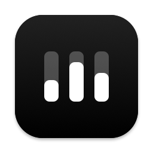
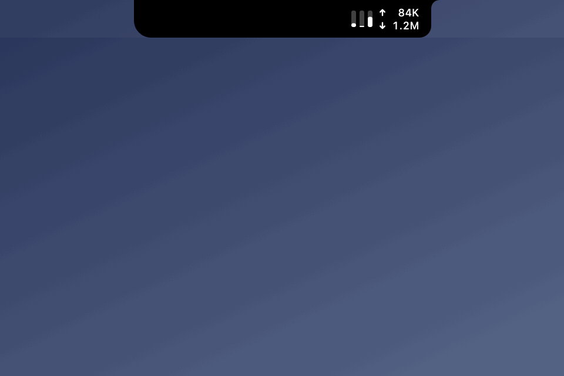
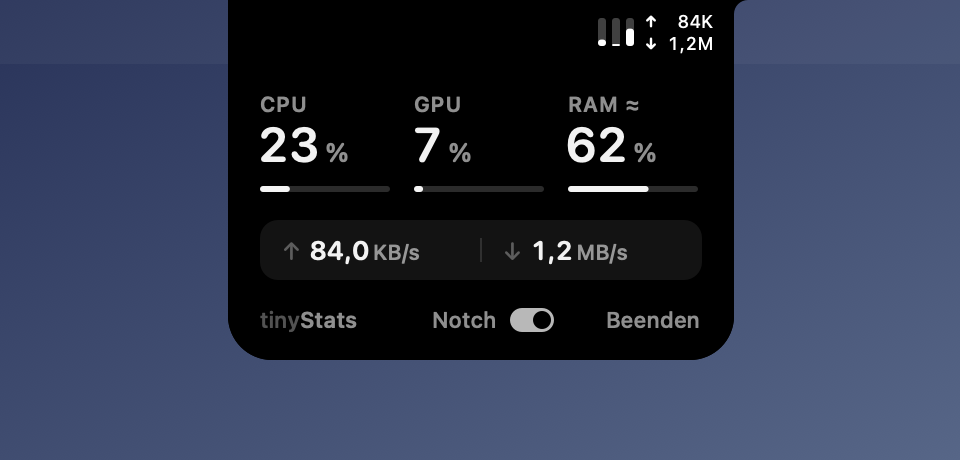
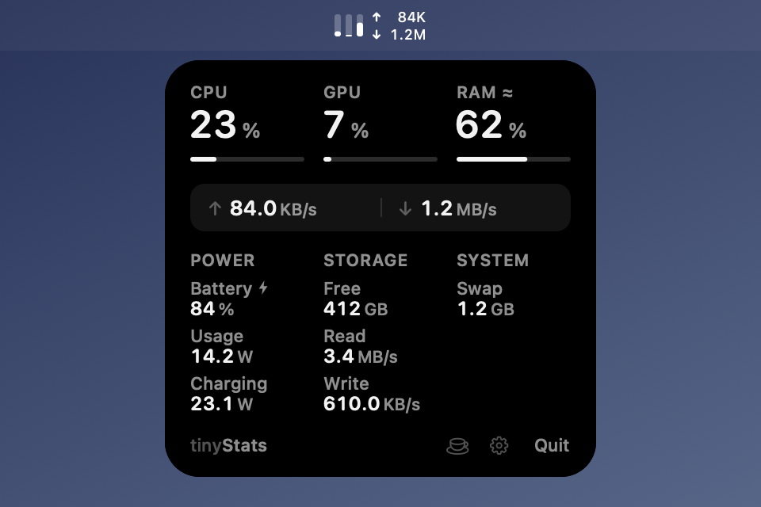

<p align="center"></p>

<h1 align="center">tinyStats</h1>

CPU, GPU, RAM and network activity beside your MacBook's notch. On displays without a notch, it lives in the menu bar. Click to open the details.

**[Download tinyStats.dmg](https://github.com/tschnorpfeil/tinyStats/releases/latest/download/tinyStats.dmg)** · macOS 14 or later · Apple Silicon and Intel · signed and notarized · [MIT](LICENSE)



| With a notch | Without a notch |
| :---: | :---: |
|  |  |

*Native renderings with sample values.*

The three bars match the three tiles in the details: CPU, GPU and RAM by default, from left to right. Upload ↑ and download ↓ sit alongside them. Below the tiles, the other metrics are grouped under Power (battery charge, power usage, charging rate), Storage (free space, disk activity) and System (swap). RAM usage is an estimate; GPU readings aren't available on all hardware. Macs without a battery don't show the battery metrics.

To customize, click the gear in the details. Each tile can show CPU, GPU, RAM, Battery or Disk, and the menu bar can show any one metric instead of network activity. “Check for Updates…” in the same menu opens the latest release in your browser; tinyStats itself never goes online.

The cup beside the gear keeps your Mac awake, like `caffeinate -i`. Point at it and the footer says what a click does. Click and the cup fills up; while it's full, the footer reads “Mac stays awake”. Downloads and builds keep running, but the display can still turn off, and closing the lid still puts the Mac to sleep unless it's on power with an external display. Click again, or quit tinyStats, to let it sleep.

tinyStats is about 2,000 lines of Swift on AppKit, with no dependencies. It makes no network connections, starts nothing in the background and has no Dock icon.

## Install

### Download

Open [tinyStats.dmg](https://github.com/tschnorpfeil/tinyStats/releases/latest/download/tinyStats.dmg), drag tinyStats to Applications and open it. To quit, open the details and click Quit. To start it at login, add it under System Settings → General → Login Items. To update, download the new version and replace the app.

### Homebrew

```sh
brew tap tschnorpfeil/tinystats https://github.com/tschnorpfeil/tinyStats
brew install tschnorpfeil/tinystats/tinystats
```

Homebrew builds the app on your Mac. The full name `tschnorpfeil/tinystats/tinystats` also marks the formula as trusted, which Homebrew requires for third-party taps.

### From source

Install Xcode Command Line Tools (`xcode-select --install`) and run:

```sh
git clone https://github.com/tschnorpfeil/tinyStats.git && ./tinyStats/install.sh
```

Homebrew and the source installer add a `tinystats` command. Open a new terminal:

```sh
tinystats          # start
tinystats stop     # quit
tinystats update   # update and restart (also after brew upgrade)
tinystats status   # check whether the app is running
tinystats version  # installed version
```

On a MacBook, tinyStats always keeps its place beside the notch. In a very full menu bar it covers the icons closest to the notch; to move it into the menu bar instead, click the gear in the details and turn off “Show Beside Notch”.

[Installation, troubleshooting and removal](INSTALL.md)

## Develop

```sh
./build.sh
open tinyStats.app
./Tests/run.sh
./Tests/install.sh
./docs/render.sh   # regenerate the images in docs/
```

To release, raise `CFBundleShortVersionString` in `build.sh` and the `tag:` in `Formula/tinystats.rb`, merge, then push the matching tag, e.g. `git tag v2.4 && git push origin v2.4`. `./release.sh` builds the signed, notarized `tinyStats-<version>.dmg`; attach it to the GitHub release as `tinyStats.dmg`. The one-time signing setup is described at the top of `release.sh`.
